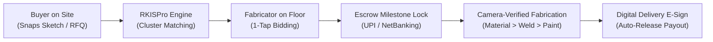
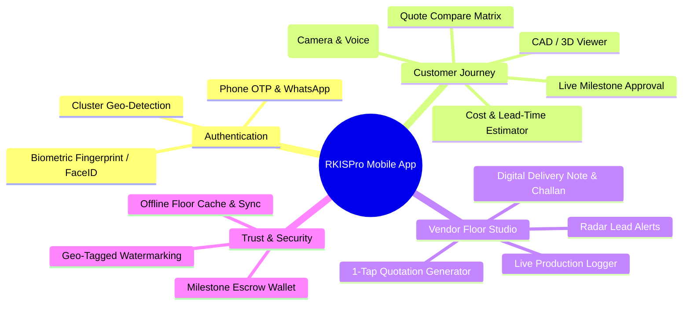
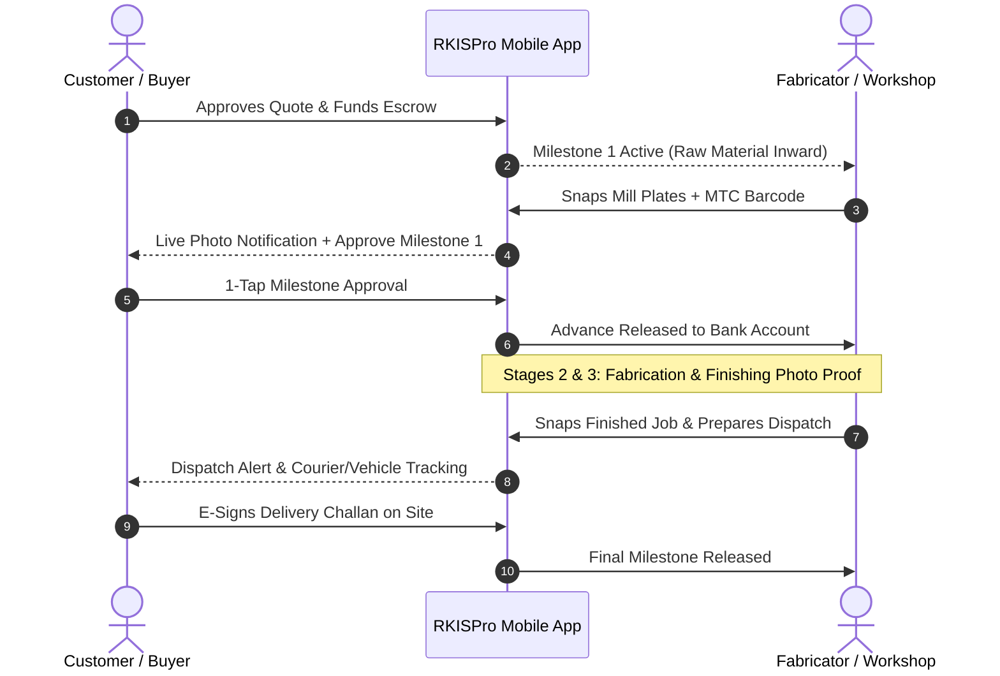
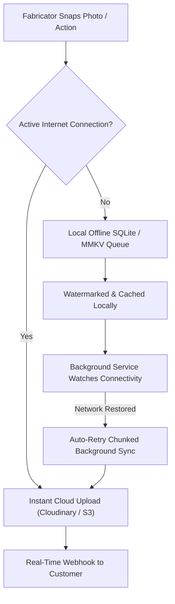
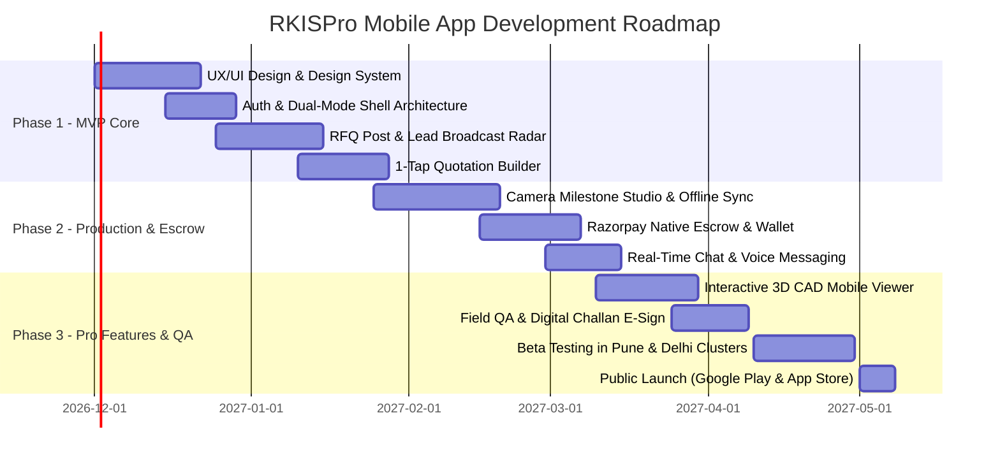

# RKISPro Mobile Application — Master Product Requirement Document (PRD)
**Version:** 1.0.0 | **Status:** Approved for Development | **Target Release:** Q1 2027  
**Platform:** Cross-Platform Native Mobile App (iOS & Android — React Native / Expo)  
**Product:** RKISPro — India's Managed Industrial Procurement & Custom Metal Fabrication Marketplace  

---

## 1. Executive Summary & Vision

### 1.1 Product Vision
**RKISPro Mobile** brings India's custom fabrication and industrial procurement ecosystem into the pockets of factory owners, procurement engineers, site supervisors, and workshop fabricators. 

While the RKISPro Web Platform excels at desktop-heavy engineering reviews and administrative dashboards, industrial fabrication physically happens on **factory floors, construction sites, and machine shop sheds**. In these environments, PC access is nonexistent, communications occur in fragmented WhatsApp threads, and quality disputes happen due to unrecorded work-in-progress.

RKISPro Mobile transforms this chaotic interaction into a **streamlined, camera-first, milestone-secured workflow**:
- **For Buyers / Project Managers:** Post an RFQ from a construction site in 30 seconds by snapping a sketch or recording a voice note; review standardized bids; view daily stage-by-stage photo/video proof; and release milestone payments with 1 tap.
- **For Workshops / Fabricators:** Receive targeted push notifications for high-intent fabrication jobs in their cluster; generate professional quotes in under 2 minutes with localized steel rate helpers; snap photos of raw material inward, welding, and painting to unlock payment milestones; and collect digital signatures on delivery.



---

## 2. Target Personas & Core Value Propositions

| Persona | Environment & Role | Current Pain Points on WhatsApp/Phone | RKISPro Mobile Value Proposition |
| :--- | :--- | :--- | :--- |
| **Industrial Buyer / Site PM**<br>*(Ramesh, 38, Project Engg)* | Active on job sites, plants, and structural assemblies. | • Fragmented WhatsApp quotes.<br>• Zero fabrication progress visibility.<br>• Unreliable delivery promises.<br>• Advances lost to unresponsive vendors. | • Instant RFQ via camera sketch & voice note.<br>• Live stage-by-stage photo verification.<br>• Escrow milestone protection.<br>• Standardized quote comparisons. |
| **Workshop Owner / Fabricator**<br>*(Suresh, 44, Shed Fabricator)* | On factory floor (MIDC, Peenya, Manesar, Guindy). Rarely uses PC. | • Missing high-value job leads.<br>• Time-consuming quotation drafting.<br>• Constant customer payment delays.<br>• Unpaid client scope revisions. | • Instant push notifications for nearby jobs.<br>• 1-tap quote builder with local steel rate assist.<br>• Camera-verified milestone payout triggers.<br>• Assured payment in escrow before starting. |
| **Field QA / Ops Inspector**<br>*(Anand, 32, RKISPro Quality Lead)* | Inspecting vendor workshops and measuring tolerances. | • Paper-based inspection logs.<br>• Delayed MTC (Mill Test Certificate) audits.<br>• Disputed weld quality post-dispatch. | • In-app digital inspection checklist.<br>• Geo-tagged & timestamped photo capture.<br>• Direct barcode/QR scanning of MTCs. |

---

## 3. Product Architecture & Dual-Mode Persona Model

To ensure unified branding and maximum discoverability on Google Play and Apple App Store, **RKISPro Mobile is built as a Single Unified Binary (`.apk` / `.ipa`)** with a fluid **Contextual Dual-Mode Switcher**:

```
[ Unified Login: Phone Number + WhatsApp OTP ]
                       │
       ┌───────────────┴───────────────┐
       ▼                               ▼
[ Customer / Buyer Mode ]     [ Vendor / Partner Mode ]
 • Post RFQ (Camera/Voice)     • Job Lead Stream & Alerts
 • Compare Quotations          • 1-Tap Quotation Builder
 • Live Project Tracker        • Milestone Upload (Photo/Video)
 • Escrow Payment Release      • Payout Wallet & Bank Accounts
       │                               │
       └───────────────┬───────────────┘
                       ▼
          [ Top Quick-Switch Pill ]
       (Toggle mode anytime with 1 tap)
```

> [!NOTE]
> Registered vendors who also occasionally buy raw materials or subcontract turning/laser cutting can toggle between **"Buying"** and **"Fabricating"** without logging out.

---

## 4. Key Feature Epics & Functional Specifications



---

### Epic 1: Frictionless Industrial Onboarding & Auth

#### 1.1 Fast Mobile Authentication
- **Primary Auth:** Phone Number + WhatsApp OTP / SMS OTP (via Fast2SMS / Twilio).
- **Secondary / Biometric:** Local device Biometric Authentication (Face ID / Android Fingerprint) for instant subsequent opens and authorization of escrow funds.
- **Language Localization:** English, Hindi, and regional industrial vernaculars (Marathi, Tamil, Gujarati, Kannada).

#### 1.2 Guided Profile Setup
- **Buyer Profile:** Company/Factory Name, GSTIN (auto-fetches trade name & registered address via GST API), Default Delivery Pin Code.
- **Fabricator Profile:** Workshop Name, Industrial Cluster location (e.g., *MIDC Bhosari, Pune*), Workshop Machinery Checklist (CNC Laser, 200A TIG/MIG, Hydraulic Press Brake, Lathe, Powder Coating Booth), Monthly tonnage capacity.

---

### Epic 2: Customer RFQ Studio & Mobile Estimator

#### 2.1 Instant Camera & Voice RFQ Creation
- **Visual Capture:** Direct camera integration with grid overlays for framing hand-drawn notebook sketches, physical sample parts, or site structural locations.
- **Voice Note Description:** Embedded audio recorder (up to 90 seconds) allowing the buyer to verbally explain tolerances, material grades, or specific fitting instructions in vernacular language.
- **Material & Process Quick Chips:**
  - *Base Metal:* Mild Steel (IS 2062), Stainless Steel (SS 304, SS 316), Aluminum (6061-T6), Brass/Copper.
  - *Processes Required:* Laser Cutting, V-Bending, TIG/MIG Welding, Lathe Turning, Sandblasting, Red Oxide Primer, Powder Coating, Hot-Dip Galvanizing.
- **File Upload:** Upload engineering PDFs, DWG/DXF drawings, and 3D CAD files (.STEP, .STL) directly from device files or WhatsApp download folder.

#### 2.2 Mobile Metal Cost Estimator
- Quick calculator mirroring the web estimator:
  - Input: Category (Gate, Stair Railing, Shed Truss, Machine Frame, Tank) + Metal Grade + Dimensions (Length × Height × Depth in feet or mm).
  - Output: Instant estimated market price bracket (e.g., `₹180 - ₹280 / sq.ft` or `₹85/kg`), estimated fabrication lead-time (3–5 days), and recommended workshop tier.

---

### Epic 3: Vendor Floor Studio & 1-Tap Quotation Engine

#### 3.1 Live Job Radar & Push Broadcasts
- Push notifications trigger with custom industrial alert sounds when a new RFQ is posted within the fabricator’s specialized radius or capability profile.
- **Job Card Snapshot:** Clear display of Job Type, Distance, Estimated Tonnage, Required Material, and Submission Deadline countdown timer.

#### 3.2 1-Tap Quotation Builder
Fabricators on the shop floor can build quotes without typing long letters:
1. **Material Cost Calculator:** Select metal grade $\rightarrow$ app suggests current benchmark raw material price per kg $\rightarrow$ vendor inputs estimated weight in kg.
2. **Operations & Labor:** Standard rate toggles for cutting, welding hours, machining, and surface treatment.
3. **Logistics & Taxes:** Transport cost slider + GST 18% auto-computed.
4. **Delivery Promise:** Date picker with lead-time validation.
5. **Output:** System automatically compiles a professional, branded PDF Quotation stamped with the vendor's logo and terms.

---

### Epic 4: Milestone Tracker & Camera-First Verification

Industrial buyers fear paying advances to contractors who disappear. RKISPro Mobile enforces **5-Stage Verified Production Tracking**:



#### Verification Rules:
- **Watermarked Proof:** All photos and video clips captured in-app receive hardcoded, non-tamperable watermarks: `Date`, `Time (IST)`, `GPS Coordinates`, `Job ID`, and `Milestone Stage`.
- **MTC (Mill Test Certificate) Scanner:** Built-in scanner to snap material test certificates for traceability against grade fraud.

---

### Epic 5: Escrow Payment & Milestone Wallet

#### 5.1 Financial Flow & Controls
- **Buyer Payment Options:** UPI (Google Pay, PhonePe, Paytm, BHIM via native Intent), NetBanking (50+ banks), Corporate Credit/Debit Cards, NEFT/RTGS virtual account generator.
- **Escrow Hold Dashboard:** Visual progress bar showing Total Order Value, Amount Safely Locked in Escrow, Amount Released to Date, and Balance Due.
- **Vendor Payout Wallet:** Fabricators track cleared payouts, upcoming milestone unlocks, and initiate instant IMPS/NEFT transfers to their registered workshop bank account.

---

### Epic 6: Interactive 3D CAD & Drawing Viewer

- **Embedded Native 3D Engine:** High-performance Three.js / WebGL viewport supporting `.STL`, `.OBJ`, and lightweight `.STEP` exports.
- **Shop Floor Features:**
  - Pinch-to-zoom, rotate, pan, and exploded view.
  - Section plane cutter to view internal hollow sections or wall thicknesses.
  - Dimension tape measure tool for quick verification against physical raw stock.
  - Redline Drawing Annotations: Circle a feature on the mobile screen, add an arrow, and attach a text comment directly to the project chat thread.

---

### Epic 7: Real-Time Chat & Voice Note Hub

- WhatsApp-like conversational experience tied directly to project milestones.
- **Scope Creep Protection:** When either party requests a specification change (e.g., *"increase thickness from 2mm to 3mm"*), the app prompts: *"Create Scope Variation Proposal (+₹4,200)?"*. Once approved, the escrow contract updates automatically.
- Media tab separating drawings, inspection reports, invoices, and payment receipts.

---

### Epic 8: Digital Delivery Challan (E-Sign & Geo-Dispatch)

- **Driver / Dispatch Mode:** Vendor inputs vehicle number and driver contact.
- **Delivery Challan QR Code:** When goods arrive at the buyer's gate, the site receiver scans the QR code on the driver's phone.
- **Digital E-Signature:** Receiver inspects delivery count, checks for transit damage, and signs on the smartphone screen with their finger.
- Signing automatically completes the final delivery milestone and triggers disbursement.

---

## 5. Offline-First Architecture & Floor Resilience

> [!IMPORTANT]
> Industrial sheds and fabrication yards are notoriously prone to spotty 2G/4G connectivity due to heavy tin roofs and structural steel framing. The app cannot afford to fail when a fabricator hits "Upload".



1. **Local State Store:** Built with **WatermelonDB / MMKV** for instantaneous reads/writes even when completely disconnected.
2. **Client-Side Image Compression:** Pre-compresses raw 12MP camera images to optimized 1200px WebP files (<250KB) directly on the device using native threads before queuing for upload.
3. **Chunked Video Upload:** 10-second inspection clips are compressed into H.265/MP4 chunks with resume capability.

---

## 6. Technical Stack & Implementation Architecture

```
┌──────────────────────────────────────────────────────────┐
│                   RKISPro Mobile App                     │
│               React Native + Expo SDK 52                 │
│        TypeScript • NativeWind (Tailwind CSS Mobile)      │
└────────────────────────────┬─────────────────────────────┘
                             │
     ┌───────────────────────┼───────────────────────┐
     ▼                       ▼                       ▼
[ State & Cache ]   [ Native Hardware ]     [ Third-Party SDKs ]
• TanStack React    • Camera & Mic API      • Razorpay React Native
  Query v5          • Biometrics (Expo)     • Firebase Cloud
• WatermelonDB /    • Background Fetch        Messaging (FCM)
  MMKV Storage      • Three.js (Expo GL)    • Expo Location & GPS
     │                       │                       │
     └───────────────────────┼───────────────────────┘
                             │
                             ▼ (Secure HTTPS / WSS API Gateway)
┌──────────────────────────────────────────────────────────┐
│             RKISPro Backend Infrastructure               │
│          Next.js App Router API Routes & Workers         │
│          Supabase PostgreSQL + Realtime Channels         │
│          Cloudinary Media CDN & Storage                  │
└──────────────────────────────────────────────────────────┘
```

---

## 7. App Information Architecture (Sitemap)

```
RKISPro Mobile App
├── (Auth / Welcome)
│   ├── Mobile Number + OTP Screen
│   ├── WhatsApp Quick Login
│   └── Profile Onboarding (Buyer vs. Fabricator setup)
│
├── [Buyer Mode Navigation - Bottom Tab Bar]
│   ├── Tab 1: Discover / Home (Quick RFQ, Metal Rates, Featured Vendors)
│   ├── Tab 2: Directory (Filter workshops by machine, cluster, rating)
│   ├── Tab 3: My Orders / RFQs (Active orders, milestone trackers, quotes)
│   ├── Tab 4: Messages / Chat (Project discussions, drawing markups)
│   └── Tab 5: Account (Company details, GST, Payment methods, Settings)
│
└── [Fabricator Mode Navigation - Bottom Tab Bar]
    ├── Tab 1: Lead Radar (Live RFQ broadcasts, distance, bidding timer)
    ├── Tab 2: My Jobs (Active orders, milestone upload studio, dispatch)
    ├── Tab 3: Quote Manager (Drafted, submitted, and won quotes)
    ├── Tab 4: Payout Wallet (Escrow balance, cleared funds, bank account)
    └── Tab 5: Workshop Profile (Machinery list, photos, cluster location)
```

---

## 8. Release Roadmap & Milestones



### Phase 1: MVP Core (6 Weeks)
- WhatsApp / Phone OTP login with Buyer/Vendor mode switcher.
- Instant Camera RFQ & Voice Note submission.
- Real-time Push Notification alerts for nearby workshops.
- 1-Tap Quotation builder for vendors with auto-generated PDFs.

### Phase 2: Floor Milestone & Escrow (5 Weeks)
- 5-Stage Camera verification pipeline with GPS & timestamp watermarks.
- Offline SQLite caching with background upload retry.
- Native Razorpay Escrow payment lock & milestone bank account disbursements.
- Milestone-anchored chat and voice messaging.

### Phase 3: Advanced Features & Launch (5 Weeks)
- Three.js mobile CAD / drawing viewer with dimension tape.
- Digital Delivery Challan with site receiver fingertip e-signing.
- Pilot launch across Pune (Bhosari/Chakan) and Delhi-NCR (Manesar/Faridabad) clusters.

---

## 9. App Store Optimization (ASO) & Store Listing Strategy

- **App Title (Android):** `RKISPro: Industrial Fabrication & RFQ Marketplace`
- **App Title (iOS):** `RKISPro - Metal Fabrication & B2B Procurement`
- **Short Description:** *Post metal fabrication RFQs, get instant verified workshop quotes, track daily milestone photos, and pay safely via milestone escrow.*
- **Target Keywords:** `Metal Fabrication India`, `Laser Cutting Pune`, `SS Railing Contractor`, `Industrial RFQ`, `Fabrication Machine Shop`, `Welding Contractors Near Me`, `B2B Manufacturing App`.

---
*Document maintained by the RKISPro Product & Engineering Team.*
