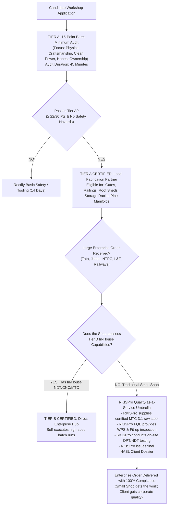
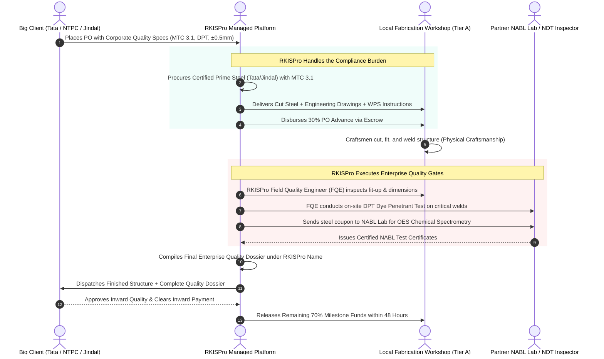

# RKISPro Progressive Workshop Audit Framework (WAF-40)
**Document ID:** `RKIS-QA-SOP-WAF-02` | **Version:** `2.0 (Progressive Two-Tier Release)`  
**Applicability:** Small Local Fabrication Workshops to Precision CNC & Heavy Industrial Hubs  
**Author:** RKISPro Quality Assurance & Engineering Operations  
**Operating Clusters:** Bilaspur (Sirgitti, Tifra), Raipur (Urla, Bhanpuri, Rawabhata), Central India  

---

## Executive Overview: The Shop-Floor Reality

A common failure of industrial aggregators is applying complex aerospace/automotive audit manuals (demanding climate-controlled inspection rooms, ASME-certified welders, and ISO manuals) to small local fabrication workshops. 

In real-world manufacturing hubs like **Sirgitti, Tifra, Urla, and Bhanpuri**, small workshops (with 4 to 10 welders, lathe turners, and fitters) possess excellent physical metalworking craftsmanship, but **almost zero formal paperwork, calibration logs, or corporate certifications**.

If an aggregator demands 40 corporate documentation points upfront, **90% of local machine shops are disqualified**, cutting the platform off from ground-level capacity.

### The RKISPro Solution: The Progressive Two-Tier Audit & Managed Bridge

RKISPro splits the 40-point framework into two distinct, practical operational tiers:



---

## PART I: TIER A — The 15-Point Bare-Minimum Checkpoint Audit
*(The "Local Essential Gate" — Completed on-site in 45 minutes by an FQE)*

**Goal:** Onboard working local workshops for standard commercial, residential, and light industrial jobs (gates, structural sheds, storage racks, railings, equipment guards, material carts, basic hopper repair).  
**Tolerances:** $\pm 1.0\,\text{mm}$ to $\pm 3.0\,\text{mm}$ (Standard fabrication tolerances).  
**Documentation Required from Shop:** Basic business proof only. **Zero corporate paperwork required.**

### The 15 Bare-Minimum Checkpoints (Scored 0, 1, or 2 | Max 30 Points)

| # | Checkpoint | Ground-Level Test Conducted by FQE | Pass Standard | Score (0-2) |
|:---:|:---|:---|:---|:---:|
| **01** | **Entity Legitimacy & Banking** | Verify GSTIN (or MSME Udyam) and active bank account / UPI for weekly milestone payouts. Check owner's physical presence and operational longevity ($\ge 2$ years in the cluster). | Active GST / Udyam + clean bank passbook/canceled check. | [ &nbsp; ] / 2 |
| **02** | **Covered Shed & Vehicle Access** | Covered workspace ($\ge 1,200\,\text{sq.ft}$) with dry floor. Paved access road for 16-ton / 25-ton multi-axle trucks to load structural trusses and heavy assemblies. | Trucks can enter and turn without blocking traffic. | [ &nbsp; ] / 2 |
| **03** | **Connected Electrical Power** | Stable industrial power connection ($\ge 15\,\text{kVA}$ to $25\,\text{kVA}$). Main switchboard has functional MCBs/breakers (no exposed live jumper wires). | Can run 2 MIG/ARC machines and a chop saw simultaneously. | [ &nbsp; ] / 2 |
| **04** | **Welding Machine Health** | Minimum 2 functional welding machines: 400A Inverter ARC/SMAW or MIG/MAG (CO2) with clean cables and secure copper ground clamps. | Continuous, stable arc without machine thermal trip. | [ &nbsp; ] / 2 |
| **05** | **Cutting & Slicing Equipment** | Functional gas cutting set (Oxy-LPG or Oxy-Acetylene) with clean cutting tips, flashback arrestors, and abrasive chop-saw for clean pipe/tube slicing. | Clean square cuts without excessive melted slag beard. | [ &nbsp; ] / 2 |
| **06** | **Basic Grinding & Finishing Tools** | Working 4-inch and 7-inch heavy angle grinders with safety wheel guards. Wire cup brushes for weld spatter removal. | Grinders operational with sound bearings and tight guards. | [ &nbsp; ] / 2 |
| **07** | **Squareness & Angular Rigidity** | Workshop possesses heavy steel tri-squares ($90^\circ$ squares) and magnetic right-angle clamps. Check right-angle accuracy against a calibrated reference. | Tri-square is true ($90^\circ \pm 0.5^\circ$), not dropped or bent. | [ &nbsp; ] / 2 |
| **08** | **Linear Measuring Accuracy** | Check shop steel measuring tapes (5m and 30m) against FQE's master stainless steel rule. Verify tapes are not kinked, stretched, or have loose end rivets. | Tape error $< 1.0\,\text{mm}$ over 3.0 meters length. | [ &nbsp; ] / 2 |
| **09** | **Basic Caliper Measurement** | Workshop possesses at least one working manual or digital vernier caliper ($150\,\text{mm}$ or $300\,\text{mm}$) to verify plate, sheet, and pipe wall thickness. | Caliper jaws close cleanly with zero light gap at zero mark. | [ &nbsp; ] / 2 |
| **10** | **Magnetic Drill / Pillar Drill** | Functional magnetic base drill (for on-site holes) or heavy pillar drill press ($13\,\text{mm}$ to $32\,\text{mm}$ chuck capacity) with no excessive spindle wobble. | Drills clean perpendicular holes without oblong ovality. | [ &nbsp; ] / 2 |
| **11** | **Weld Penetration Craftsmanship** | **Physical Test:** FQE hands two scrap steel plates ($8\,\text{mm}$ or $10\,\text{mm}$). Shop welder welds a standard T-fillet joint. FQE breaks or cuts the joint to inspect root penetration. | Good root fusion; zero visible cold lapping; uniform ripple bead. | [ &nbsp; ] / 2 |
| **12** | **Diagonal Trueness (Box Checking)** | **Physical Test:** FQE inspects an existing fabricated gate, window frame, or truss on the shop floor. Checks diagonal corners ($A \text{ to } C$ vs $B \text{ to } D$). | Diagonal difference $\le 2.0\,\text{mm}$ over a 2-meter rectangle. | [ &nbsp; ] / 2 |
| **13** | **Grind Finish & Spatter Cleanup** | Finished workpieces must have all weld spatter chiseled off, sharp cutting burrs ground smooth, and weld beads dressed uniformly before primer application. | Smooth touch on hand swipe; no sharp finger-cutting edges. | [ &nbsp; ] / 2 |
| **14** | **Basic Shop Safety & Earthing** | Earthing cables clamped directly to welding tables (not hooked to loose rebar). Workers wear leather welding shields, hand gloves, and closed shoes. | Proper welding earth return; basic PPE in active use. | [ &nbsp; ] / 2 |
| **15** | **Owner Integrity & Communication** | Owner/supervisor is responsive on mobile phone, understands delivery schedule commitments, and willing to follow FQE guidance on customer milestones. | Transparent communication; agrees to FQE pre-dispatch checks. | [ &nbsp; ] / 2 |

### Tier A Scoring & Activation Threshold
- **Total Points:** 30 Points Max.
- **Pass Threshold:** **$\ge 22$ Points (73%)** with no severe electrical hazard.
- **Onboarding Status:** Certified as **RKISPro Tier A Fabrication Partner**.
- **Eligible Commercial Orders:** Structural sheds, sliding gates, mezzanine racks, window grills, boundary railings, conveyor supports, storage hoppers.

---

## PART II: TIER B — The 25-Point Enterprise & Big-Client Add-On Audit
*(What is Required to Get Orders from Tata, Jindal, NTPC, L&T, BHEL, and Indian Railways)*

When dealing with large public and private sector industrial buyers, physical skill is only 40% of the requirement. The remaining 60% is **Traceability, Metrology, Certification, and Quality Governance**.

To qualify as a direct **Tier B Precision Enterprise Hub**, a facility must satisfy these **25 Advanced Checkpoints** (or operate under the RKISPro Quality Umbrella described in Part III):

```
                        ENTERPRISE REQUIREMENTS FOR BIG CLIENTS
┌─────────────────────────────────┬────────────────────────────────────────────────────────┐
│ Enterprise Procurement Demand   │ Specific Shop-Floor Standard Required                  │
├─────────────────────────────────┼────────────────────────────────────────────────────────┤
│ 1. Zero Material Fraud          │ Primary Mill Test Certificates (MTC 3.1) + OES Spark   │
│ 2. Guaranteed Weld Strength     │ Certified Welders (ASME Sec IX / AWS D1.1) + WPS / PQR │
│ 3. Hidden Crack Detection       │ In-House / Partner NDT Testing (DPT, MPI, Ultrasonic)  │
│ 4. Sub-50 Micron Tolerances     │ VMC / CNC Milling / Turning with calibrated tooling    │
│ 5. Certified Paint Protection   │ Sa 2.5 Sand Blasting + Digital DFT Micron Measurement  │
│ 6. Full Legal Dossier           │ Digitally signed Inspection Dossier attached to PO    │
└─────────────────────────────────┴────────────────────────────────────────────────────────┘
```

### The 25 Enterprise Checkpoints (Grouped by Operational Discipline)

#### Category 1: Raw Material Metallurgy & Traceability (Points 16–19)
- **16. Primary Mill Sourcing (MTC 3.1):** Raw steel plates and structural beams sourced strictly from primary producers (Tata Steel, SAIL, Jindal Steel & Power). Every heat number stamped on the plate must match the original mill certificate.
- **17. Chemical Spectrometry (OES Testing):** In-house optical spectrometer or contracted NABL laboratory testing verifying exact percentage of Carbon ($C$), Manganese ($Mn$), Silicon ($Si$), Sulfur ($S$), and Phosphorus ($P$).
- **18. Mechanical Tensile & Impact Testing:** Certified Yield Strength ($R_{eH}$), Ultimate Tensile Strength ($R_m$), and Charpy V-Notch impact values at specified temperatures (e.g., $-20^\circ\text{C}$ for structural steel).
- **19. Material Segregation & Heat Traceability:** Steel off-cuts hard-punched or stencil-marked with the original heat number before cutting, preventing alloy cross-contamination.

#### Category 2: Certified Welding Engineering (Points 20–25)
- **20. Qualified Welding Procedure Specs (WPS):** Documented, pre-qualified welding procedures detailing base metal thickness, joint design, welding current (Amps), voltage (Volts), travel speed, and gas flow rates.
- **21. Procedure Qualification Records (PQR):** Mechanical tensile and bend test results proving that the WPS produces full-strength joints without cracking.
- **22. Welder Performance Qualification (WPQ / WQT):** Every welder possesses a valid qualification certificate stamped by a recognized third-party inspection agency (TUV, DNV, Bureau Veritas, or EIL) under **ASME Section IX or AWS D1.1**.
- **23. Low-Hydrogen Electrode Baking Protocols:** Temperature-controlled mother oven ($250^\circ\text{C}-350^\circ\text{C}$) for baking E7018 electrodes, and portable heated quivers ($100^\circ\text{C}-150^\circ\text{C}$) carried by welders on the shop floor.
- **24. Plate Edge Beveling & Root Gap Control:** Automated or mechanical beveling machines ensuring precise $30^\circ - 35^\circ$ bevel angles, $1.5 - 2.5\,\text{mm}$ root faces, and uniform root gaps prior to tack welding.
- **25. Inter-Pass Temperature & Purging (for SS/Alloys):** Calibrated digital infrared pyrometers / temperature chalks used to verify pre-heat and inter-pass temperatures. Argon gas back-purging setups for Stainless Steel TIG welding.

#### Category 3: Non-Destructive Testing (NDT) Readiness (Points 26–29)
- **26. Liquid Dye Penetrant Testing (DPT):** In-house certified ASNT / ISNT Level II technician conducting solvent-removable dye penetrant inspection on 100% of full-penetration butt welds to detect surface micro-cracks and lack of fusion.
- **27. Magnetic Particle Inspection (MPI):** Magnetic yoke equipment for detecting surface and near-subsurface flaws in ferromagnetic structural welds.
- **28. Ultrasonic Flaw Detection (UT):** Retainer contract or in-house capability for ultrasonic shear-wave testing of thick plate butt welds ($> 12\,\text{mm}$) to detect internal slag inclusions, porosity, and laminations.
- **29. Radiographic Testing (RT / X-Ray) Access:** Coordination with licensed BARC-approved industrial radiography agencies for pipeline and pressure vessel butt weld X-rays.

#### Category 4: Precision CNC Machining & Calibration (Points 30–34)
- **30. CNC / VMC Multi-Axis Machinery:** High-rigidity VMCs or CNC Turning Centers capable of holding engineering tolerances down to $\pm 0.015\,\text{mm}$ ($\pm 15\,\mu\text{m}$).
- **31. Spindle Dynamic Runout Verification:** Machine spindle radial runout $< 0.005\,\text{mm}$ measured with a 300 mm test bar; axis backlash $< 0.010\,\text{mm}$.
- **32. NABL Calibration Master Certificates:** 100% of measuring hand tools (digital calipers, outside micrometers, bore gauges) have valid NABL calibration certificates traceable to the National Physical Laboratory (NPL).
- **33. Granite Surface Plate & Digital Height Master:** Grade 00 granite surface plate with a calibrated 2D height gauge (Mitutoyo / Trimos) for precision datum plane inspection.
- **34. Surface Roughness ($Ra$) Profilometry:** Portable stylus roughness tester verifying ground, turned, and milled surfaces down to $Ra \le 0.8\,\mu\text{m}$ to $1.6\,\mu\text{m}$.

#### Category 5: Surface Preparation & Protective Coating (Points 35–37)
- **35. Grit Blasting / Sand Blasting Facility:** Enclosed blasting booth achieving surface profile cleanliness to **ISO 8501-1 Sa 2.5 standard** (near-white blast cleaning) to guarantee paint adhesion.
- **36. High-Performance Industrial Coating:** Airless spray painting systems applying multi-coat epoxy primer and polyurethane (PU) finish systems compliant with ISO 12944 industrial corrosion standards.
- **37. Digital Dry Film Thickness (DFT) Verification:** Digital magnetic/eddy-current coating thickness gauge verifying primer and topcoat thickness in microns (e.g., minimum $120\,\mu\text{m}$ to $180\,\mu\text{m}$) across representative surface points.

#### Category 6: Plant Governance, Safety & QA Dossier (Points 38–40)
- **38. Overhead EOT Crane Proof-Load Certification:** Certified overhead crane ($\ge 10\,\text{MT}$) with valid Form 11 proof-load test certificate issued by a government-approved competent person.
- **39. Formal Non-Conformance & Quarantine Process (NCR):** Physically segregated, locked quarantine area for defective parts, preventing rejected work from being accidentally dispatched.
- **40. Comprehensive Manufacturer's Data Report (MDR / Quality Dossier):** Ability to compile a complete final quality packet containing:
  - Raw Material MTC 3.1 Certificates
  - Dimensional Inspection Reports (DIR)
  - NDT Clearance Certificates (signed by Level II Inspector)
  - Blasting & Painting DFT Reports
  - Pre-Dispatch Release Note (PDRN)

---

## PART III: The RKISPro Quality Bridge — How Small Shops Deliver Big Client Orders

Small workshops in Bilaspur and Raipur **do not need to spend ₹50 Lakhs** building metrology labs or hiring corporate quality managers to win corporate orders.

**RKISPro acts as the Managed Quality Layer (The Enterprise Umbrella)**:



### Why Everyone Wins Under This Model:

1. **For the Small Local Shop**:
   - They focus 100% on what they do best: cutting, bending, fitting, and welding steel.
   - They get high-volume enterprise work that previously only went to giant contractors.
   - They get paid in **48 hours**, freeing them from 90-day corporate payment delays.
   - They don't have to hire expensive quality engineers or buy ₹30L testing machines.

2. **For the Big Corporate Buyer**:
   - They issue a **single purchase order to RKISPro Private Limited**.
   - They receive parts with **100% certified NABL paperwork, MTC 3.1 certificates, and Level-II NDT reports**.
   - RKISPro takes **100% contractual and financial liability** for dimensional accuracy and rejected parts.

3. **For RKISPro**:
   - We aggregate hundreds of small workshops without investing in factory land or machines (Zero Capex).
   - We capture an asset-light **12% to 15% managed spread** on every executed purchase order by providing the quality, escrow, and compliance umbrella.

---

## PART IV: Quick Summary & Decision Matrix

| Operational Parameter | Tier A (Bare-Minimum Local Audit) | Tier B (Direct Enterprise Hub) | Small Shop under RKISPro Quality Umbrella |
|:---|:---|:---|:---|
| **Audit Duration** | **45 Minutes on-site** | 4 to 6 Hours detailed audit | 45-Min Tier A audit + RKISPro FQE onboarding |
| **Checkpoints Evaluated** | **15 Practical Checkpoints** | Full 40 Points | 15 Checkpoints (Shop) + 25 Points (Handled by RKISPro) |
| **Typical Shop Profile** | 4–10 welders, basic shed in Sirgitti/Tifra/Urla | Modern factory with VMC, sandblasting, in-house QA | Traditional MSME workshop with skilled fitters |
| **Eligible Order Types** | Commercial gates, sheds, railings, hoppers | Critical turbine parts, defense, high-pressure vessels | Heavy industrial frames, plant spares, structural assemblies |
| **Tolerances** | $\pm 1.0\,\text{mm}$ to $\pm 3.0\,\text{mm}$ | $\pm 0.015\,\text{mm}$ to $\pm 0.5\,\text{mm}$ | $\pm 0.5\,\text{mm}$ to $\pm 1.0\,\text{mm}$ |
| **Documentation Burden on Shop** | **Zero (Basic GST/bank only)** | Heavy (WPS, PQR, NABL, ISO, Calibrations) | **Zero (Managed entirely by RKISPro)** |
| **Testing Responsibility** | Visual & FQE physical checks | In-house QA department | **RKISPro Partner NABL Labs & FQE** |
| **Payout Model** | 48-hr milestone release upon FQE pass | 48-hr milestone release upon FQE pass | 48-hr milestone release upon FQE pass |
